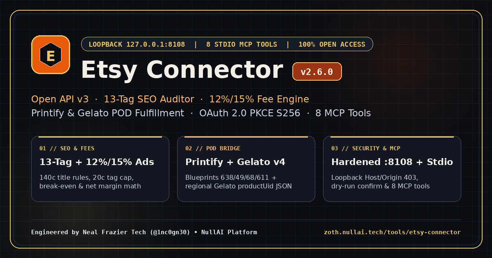

# Etsy Connector (`v2.6.0`)



> **100% Free & Open Access** · Zero External Python Dependencies · Loopback `127.0.0.1:8108` REST API + Dual-Theme Web Cockpit + 8 JSON-RPC 2.0 Stdio MCP Tools

Etsy Connector is a local-first Python standard-library server, CLI, Unicode Braille TUI, and Model Context Protocol (MCP) bridge for Etsy Open API v3 and Print-on-Demand (Printify & Gelato) seller operations.

---

## What It Does

1. **13-Tag & 140-Char Etsy SEO Auditor** — Evaluates title length (140-char limit), mobile front-loading (first 40 chars), separator hygiene, all-caps penalties, 13-tag completeness, 20-char tag caps, duplicate tags, single-word ratios, description length, and title/tag keyword overlap.
2. **Exact Etsy Fee, Offsite Ads & Break-Even Calculator** — Models `$0.20` listing fee, `6.5%` transaction fee, `3.0% + $0.25` US payment processing, and **`0%` / `12%` (`>= $10,000/yr`) / `15%` (`< $10,000/yr`)** Etsy Offsite Ads tiers, returning rounded gross revenue, net profit, net margin %, ROI %, and break-even retail price.
3. **Printify & Gelato POD Payload Builders** — Generates Printify REST API v1 product payloads (accurate blueprint & provider IDs: `638/29`, `49/29`, `68/26`, `611/3`, `0/0`) and Gelato Ecommerce API v4 localized fulfillment payloads (`productUid`, regional routing).
4. **Etsy Open API v3 Client + OAuth 2.0 PKCE S256** — Generates RFC 7636 PKCE verifiers/challenges, persists credentials atomically with `0600` permissions in `~/.etsy_connector_config.json`, URL-quotes path segments, detects upload MIME types, sanitizes `Content-Disposition` filenames, and enforces dry-run-by-default (`confirm=True` required for live draft creation, shop updates, and file/image uploads).
5. **Hardened Loopback Workstation (`http://127.0.0.1:8108`)** — Dual-theme **Editorial Ivory Light** + **Obsidian Gold Dark** 5-tab UI with zero external CDN requests, strict loopback `Host` & exact-port `Origin` `403` enforcement, all 4 security headers, `HEAD` support, `1 MiB` `413` body cap, `400` strict JSON/type validation, and `403` traversal protection.

---

## How It Works

```
┌──────────────────────────────────────────────────────────────────────────┐
│  ZothOS CLI / Braille TUI / Antigravity MCP Client (JSON-RPC 2.0 stdio) │
└──────────────────────────┬───────────────────────────┬──────────────────┘
                           │                           │
            ┌──────────────▼──────────────┐  ┌─────────▼──────────────────┐
            │  src/etsy_connector/        │  │  Loopback HTTP (:8108)     │
            │  • seo_engine.py            │  │  • web_cockpit.py          │
            │  • pod_bridge.py            │  │  • Dual-theme public/ UI   │
            │  • client.py (PKCE + v3)    │  │  • Host/Origin 403 guards  │
            │  • taxonomy.py (8 nodes)    │  │  • /api/{audit,profit,pod, │
            │  • mcp_server.py (8 tools)  │  │    search,create-draft}    │
            └─────────────────────────────┘  └────────────────────────────┘
```

---

## ZothOS CLI & MCP Commands

### Quickstart & Status
```bash
# Check daemon, credential, and MCP status
etsy-connector --status

# Machine-readable manifest
etsy-connector --json

# Launch hardened loopback workstation on 127.0.0.1:8108
python3 server.py --host 127.0.0.1 --port 8108
# or via CLI:
etsy-connector serve --port 8108

# Launch Unicode U+2800 Braille live telemetry TUI
etsy-connector-tui --once
etsy-connector-tui --once --json
```

### Core CLI Subcommands
```bash
# 1. Audit listing title and 13 search tags
etsy-connector audit \
  --title "Botanical Wildflower Heavy Blend Crewneck Sweatshirt, Cottagecore Floral Gift, Garment Dyed Pullover" \
  --tags "wildflower crewneck,botanical sweatshirt,cottagecore gift,floral pullover,garden lover gift,nature crewneck,cozy floral shirt,spring botanical,pressed flower art,embroidered look,comfort colors 1717,gift for gardener,aesthetic sweater" \
  --json

# 2. Calculate Etsy fees & break-even across 0%, 12%, or 15% Offsite Ads
etsy-connector profit --retail 38.99 --pod 15.50 --json
etsy-connector profit --retail 38.99 --pod 15.50 --offsite-ads-rate 0.12 --json
etsy-connector profit --retail 38.99 --pod 15.50 --ads --json

# 3. Generate Printify or Gelato POD fulfillment payloads
etsy-connector pod --provider printify --blueprint ceramic_mug_15oz --title "Songbird Ceramic Mug 15oz"
etsy-connector pod --provider gelato --blueprint fine_art_poster_18x24 --title "Botanical Archival Poster"

# 4. Competitor search & OAuth 2.0 PKCE S256
etsy-connector search --keywords "wildflower sweatshirt" --limit 5 --json
etsy-connector auth --key YOUR_ETSY_API_KEYSTRING
```

### 8 Model Context Protocol (MCP) Stdio Tools
Start the stdio MCP server with `etsy-connector mcp` or `PYTHONPATH=src python3 -m etsy_connector.cli mcp`:

| MCP Tool | Purpose |
| :--- | :--- |
| `etsy_search_listings` | Search active Etsy marketplace listings (falls back cleanly to simulation offline) |
| `etsy_audit_listing_seo` | Audit title (<=140c), 13 tags (<=20c), duplicates, single-word ratio, and description |
| `etsy_calculate_profit_margins` | Compute `$0.20` listing, `6.5%` tx, `3%+$0.25` processing, `0%/12%/15%` Offsite Ads, and break-even |
| `etsy_get_taxonomy_categories` | Look up canonical Etsy seller category taxonomy IDs (8 POD & digital nodes) |
| `etsy_create_draft_listing` | Create draft listing (`confirm=true` required for live writes; dry-run by default) |
| `etsy_upload_listing_image` | Upload mockup PNG/JPG/WebP (`confirm=true` required for live writes; dry-run by default) |
| `etsy_get_shop_details` | Fetch shop profile, active listing counts, and review metrics |
| `etsy_generate_pod_payload` | Build Printify REST API v1 or Gelato Ecommerce API v4 fulfillment payloads |

---

## Testing
```bash
PYTHONPATH=src pytest -q tests
```

---

## License & Support

- MIT License — 100% Free & Open Access.
- Optional support: [Buy Us a Coffee (Stripe)](https://buy.stripe.com/3cIfZg27PdKo2D64Ocfw40X) · Solana Tip: `GG2eQbVh8ut1BK6j1A2tz7pSySdLpD38BgyEhGcxdXoK`
- **Engineered by Neal Frazier Tech (@1nc0gn30) • NullAI Platform** · [GitHub](https://github.com/1nc0gn30/etsy-connector) · [NullAI](https://nullai.tech)
