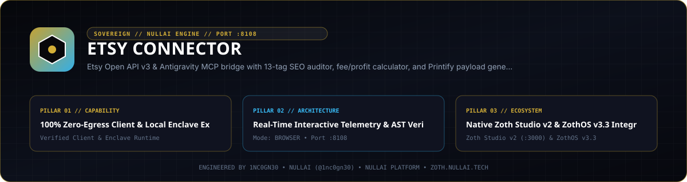
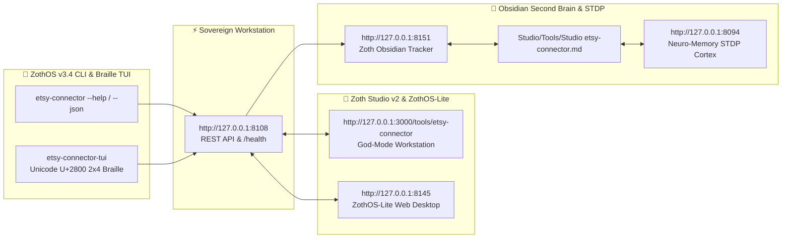

<div align="center">
  
</div>

<br />

# 🌸 Etsy Connector for Antigravity & Sovereign AI Agents

## ☕ 100% Free & Open-Access (Zero Paywalls)

Etsy Connector is **100% free, open-access, and unlocked by default**. All 8 MCP tools, 13-tag SEO rank auditors, and profit calculation models are completely free with zero paywalls.

If you find this tool valuable, optional community support is welcome via:
- **☕ Buy Us a Coffee (Stripe)**: [https://buy.stripe.com/3cIfZg27PdKo2D64Ocfw40X](https://buy.stripe.com/3cIfZg27PdKo2D64Ocfw40X)
- **◎ Solana Tip Address**: `GG2eQbVh8ut1BK6j1A2tz7pSySdLpD38BgyEhGcxdXoK` (`solana:GG2eQbVh8ut1BK6j1A2tz7pSySdLpD38BgyEhGcxdXoK`)

[](https://etsy.nullai.tech)
[](https://modelcontextprotocol.io)
[](https://python.org)
[](https://nullai.tech)

Autonomous Etsy Open API v3 and Print-on-Demand (POD) bridge for **Google Antigravity** AI agents. Exposes 8 Model Context Protocol (MCP) tools for competitor search, 13-tag SEO ranking audits, exact fee & profit modeling, and automated Printify fulfillment payloads.

---

## ⚡ 8 Model Context Protocol (MCP) Tools

When registered in `~/.gemini/config/mcp_config.json`, Antigravity gains immediate access to:

1. `etsy_search_listings`: Real-time competitor analysis, pricing, and tag discovery.
2. `etsy_audit_listing_seo`: 13-tag (≤20 chars) and Title (≤140 chars) ranking algorithm auditor.
3. `etsy_calculate_profit_margins`: Precise breakdown of Etsy fees, POD production costs, and net margin.
4. `etsy_get_taxonomy_categories`: Etsy category taxonomy ID lookup.
5. `etsy_create_draft_listing`: Programmatic draft listing generation.
6. `etsy_upload_listing_image`: Multi-angle mockup and photo uploads.
7. `etsy_get_shop_details`: Storefront metrics, reviews, and active inventory tracking.
8. `etsy_generate_pod_payload`: 1-click Printify/Gelato product fulfillment JSON generator.

---

## 🚀 Quick Start

### 1. Antigravity MCP Setup
Add to `~/.gemini/config/mcp_config.json`:
```json
{
  "mcpServers": {
    "etsy-connector": {
      "command": "/home/zoth/NullAITech/etsy-connector/bin/etsy-connector",
      "args": ["mcp"],
      "env": {
        "PYTHONPATH": "/home/zoth/NullAITech/etsy-connector/src"
      }
    }
  }
}
```

### 2. Run CLI Operations
```bash
# Calculate net margins for a $38.99 sweatshirt with $15.50 POD cost:
./bin/etsy-connector profit --retail 38.99 --pod 15.50

# Audit an Etsy listing title and tags:
./bin/etsy-connector audit --title "Grandma Garden Sweatshirt" --tags "grandma gift,garden crewneck,floral sweater"

# Launch Web Cockpit on port 8108:
./bin/etsy-connector serve --port 8108
```

---

## 📜 Attribution & License
Engineered by **1nc0gn30 • NullAI** ([@1nc0gn30](https://github.com/1nc0gn30)) • [NullAI Platform](https://nullai.tech)
MIT License.

## Network exposure

The server binds to `127.0.0.1` by default. To reach it from other devices,
opt in explicitly with `--host 0.0.0.0` (or set `ZOTH_BIND_HOST=0.0.0.0`; an IP
in `HOST` is also honoured, a plain hostname is ignored) and only on a trusted
network.

## Safety

- The browser API only accepts cross-origin requests from `localhost` / `127.0.0.1` pages. POSTs from any other website get `403`, and CORS echoes only local origins (never `*`), so a site you visit can't drive or read this local server. CLI and agent clients (no `Origin` header) are unaffected.
- Credentials (`ETSY_API_KEY`, `ETSY_ACCESS_TOKEN`, or the cockpit form) are stored in `~/.etsy_connector_config.json` with owner-only `0600` permissions and are never returned by any endpoint.
- **Live writes are dry runs by default.** With live credentials, `create-draft` (HTTP, MCP `etsy_create_draft_listing`) returns the payload it *would* send. Pass `"confirm": true`, or set `ETSY_ALLOW_LIVE_WRITES=1`, to really create the draft.
- A failed live write (auth or network error) raises an error. It never falls back to a simulated "success" with a made-up `listing_id`. Reads may fall back to simulated data, flagged with `simulation: true` and a note.

---

## 🏛️ ZothOS v3.4, Zoth Studio v2 & Obsidian Second Brain Ecosystem



### Cross-Surface Integration Matrix

| Surface | Endpoint / Binary | Capabilities |
| :--- | :--- | :--- |
| **Standalone Workstation** | `http://127.0.0.1:8108` | 100% Free & Open-Access Web Deck, live `/health` & REST telemetry |
| **Zoth Studio v2 Route** | `http://127.0.0.1:3000/tools/etsy-connector` | Interactive God-Mode component inside Zoth Studio (`https://zoth.nullai.tech`) |
| **ZothOS v3.4 CLI & TUI** | `etsy-connector` / `etsy-connector-tui` | Global binary in `/usr/local/bin/` with Unicode `U+2800` Braille TUI & `--json` output |
| **ZothOS-Lite Web Desktop** | `http://127.0.0.1:8145` | Browser-native KDE-style window manager & terminal launcher |
| **Zoth Obsidian Tracker** | `http://127.0.0.1:8151` | Interactive Obsidian Second Brain vault explorer (`~/Documents/Obsidian Vault/Studio/Tools/Studio etsy-connector.md`) |
| **Neuro-Memory STDP Cortex** | `http://127.0.0.1:8094` | 3-Factor STDP synaptic memory daemon & 21-tool MCP server |

```bash
# Inspect CLI & Unicode U+2800 Braille TUI on ZothOS v3.4
etsy-connector --help
etsy-connector-tui --status
etsy-connector-tui --json

# Verify Second Brain Vault & 12-Step Verification Gallery on :8151
zoth-obsidian-tracker --verify
```

